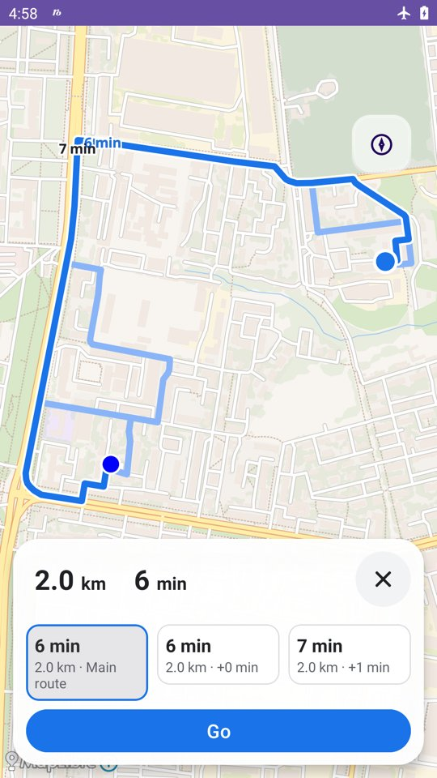
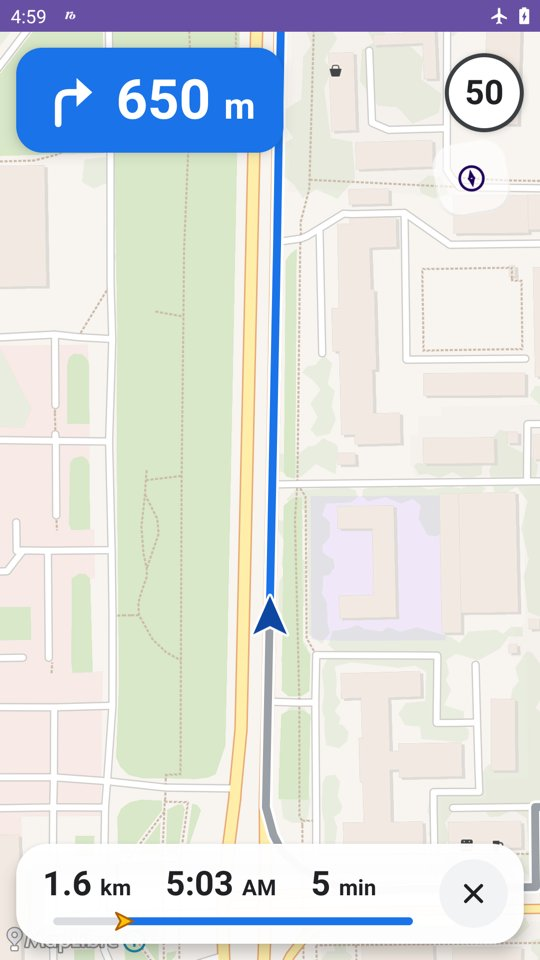
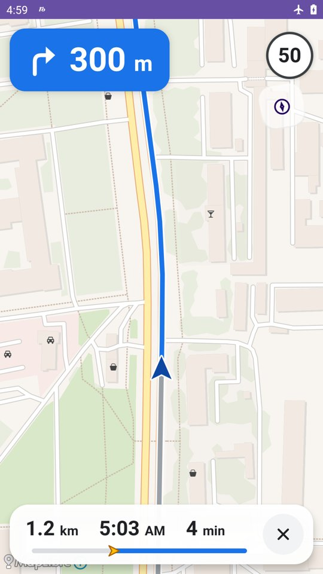

# 2Maps-And Navigation App

Android maps, offline car navigation, placemarks and GPX recording. MapLibre
renders imported MBTiles maps; the bundled BRouter engine calculates routes
locally, without a separate BRouter application or an online routing service.

## Start offline navigation

1. Install the APK from [GitHub Releases](https://github.com/mikhail-angelov/2maps-and/releases).
2. Import a `.mbtiles` map through **Maps**. The bundled map covers Malta;
   import your region to see its streets.
3. Download your region's `.rd5` files from the
   [BRouter road-data directory](https://brouter.de/brouter/segments4/) and select
   **Menu → Road data → Import .rd5 files**. Nizhny Novgorod uses `E40_N55.rd5`;
   routes east of 45° longitude may also need `E45_N55.rd5`.
4. Long press a destination or open a placemark and choose **Navigate to → Offline**.
   Choose the main route or an available alternative, then tap **Go**.
5. To get home quickly, long press the map and choose **Set as Home** (one point,
   shown as an orange house). The **Home** button in the bottom-left corner then
   starts offline navigation home.

Road data and map tiles are separate: `.rd5` files calculate routes, while
`.mbtiles` files draw the map. Once imported, both work offline. GPS improves
progress and rerouting, but an already known position is enough to plan a route.

<p>



</p>

During navigation, a compact blue card in the top-left corner shows the next
maneuver and the distance to it. The top-right corner shows the current speed
and, when present in the road data, the posted limit; the speed turns red above
the limit, and limit signs are drawn on the map where the limit changes.
The bottom bar shows remaining distance, arrival time and remaining time over a
progress bar with a position cursor, and **×** on the right to stop. While on
the route, the position arrow is snapped to the road. The map menu and locate
button are hidden; dragging the map pauses following until the bottom bar is
tapped. Outside guidance, the position is a blue dot.
Yandex Navigator and OsmAnd handoff remain available.

Time estimates do not include traffic. Voice instructions, lane guidance and
background/screen-off navigation are not implemented. GPS quality still matters
for reliable progress; initial route selection may refresh if the position changes
substantially. See [navigation setup](docs/navigation/README.md) and
[local validation](docs/navigation/VALIDATION.md).

## Key Features

<table>
<tr>
<td width="180" valign="top">

</td>
<td valign="top">

**Interactive Map:**
- Built using **MapLibre GL Native**, providing high-performance, hardware-accelerated map rendering.
- Offline OSM map is supported.
- Supports custom map styles loaded from assets, allowing for complete visual control (e.g., street, satellite, terrain views).
- Smooth pan, zoom, and tilt gestures for intuitive map exploration.

</td>
</tr>
<tr>
<td width="180" valign="top">


</td>
<td valign="top">

**Load custom Maps:**
- Allow to import offline maps in [\.mbtiles format](https://docs.mapbox.com/help/glossary/mbtiles/) with raster or vector tile sets.
- There are many tools, wich could help you to get or generate mbtiles files, e.g. [https://github.com/systemed/tilemaker](https://github.com/systemed/tilemaker).
- This is [it\'s my util](https://github.com/mikhail-angelov/2maps-loader), which help to download raster/vector tiles file for selected region/zoom, from web
- Supports easy switch between maps, right from main screen.
</td>
</tr>
<tr>
<td width="180" valign="top">

</td>
<td valign="top">

**Turn-by-Turn Navigation:**
- **Embedded BRouter:** Car routes are calculated offline in a separate app process.
- **Route alternatives:** Up to three distinct routes before starting, depending on the road network.
- **Visual guidance:** Next maneuver, distance, known speed limits, remaining time/distance and route progress.
- **Automatic rerouting:** Confirmed deviations trigger recalculation when a fresh, accurate GPS position is available; a route that continues the direction of travel is preferred over a U-turn.
- **Route visualization:** The traveled part is muted; the remaining route is highlighted.

</td>
</tr>
<tr>
<td width="180" valign="top">

</td>
<td valign="top">

**Placemark Management:**
- **Create & Save Placemarks:** Long-press anywhere on the map to save a point of interest.
- **View Placemark Details:** Click on a placemark icon to open a modal with its details.
- **List & Sort Placemarks:** View a comprehensive list of all saved placemarks, sorted by distance from your current location.
- **Item Actions:** Swipe a placemark in the list to reveal actions:
    - **Center:** Center the map on the placemark's location.
    - **Navigate:** Start a navigation route to the placemark.
    - **Share:** Share placemark coordinates.
    - **Edit:** (Functionality to be implemented).
    - **Delete:** Remove the placemark.

  </td>
</tr>
<tr>
<td width="180" valign="top">

</td>
<td valign="top">

**GPS Tracking:**
- **Record Your Path:** Records the user's GPS location history to create a track.
- **Trips:** Menu → Trips lists trips imported from Mamon, newest first. The scan button reads a trip QR code
  (`2MAPS-TRIP`, the trip name, then `lat,lng,name` per line). Tapping a trip starts offline navigation to the
  nearest unvisited point; on arrival the next nearest one is driven at once. The bottom panel shows
  `point / total · name` and a skip button; the whole trip is one GPX track.
- **Navigation Tracks:** Every guided drive is saved as its own GPX track (`navigation_<time>.gpx`) in the track list.
- **Center on Location:** A tap on the locate button centres the map on the current position; a long press opens the follow/record menu.
- **Track Visualization:** Displays the recorded track as a line on the map.
- **Clear Track:** Provides an option to clear the currently recorded track from the map.

**Location Services Integration:**
- **Location providers:** Google/Huawei fused updates for normal use, system GPS updates during navigation.
- **Current Location Indicator:** A blue dot outside guidance; a direction arrow during guidance when a course is known.
- **"Center on Me" Functionality:** A floating action button allows the user to re-center the map on their current GPS location.

  </td>
</tr>
<tr>
<td width="180" valign="top">

</td>
<td valign="top">

**Gas Stations:**
- **Map Layer & Toggle:** Explained that gas stations appear on a separate map layer that can be shown or hidden, with the visibility state being saved.
- **Import from File:** Clarified that gas stations are imported from .geojson files, with logic to prevent duplicate entries.
    - **.geojson** file could be loaded from [https://overpass-turbo.eu/](https://overpass-turbo.eu/) with the following query:
```
node
  [amenity=fuel]
  ({{bbox}});
out;
```
  </td>
</tr>
</table>


### Modern Android Architecture:
- **MVVM Architecture:** Separates UI logic from business logic using ViewModels (`PlacemarksViewModel`, `LocationViewModel`, `TrackViewModel`).
- **Kotlin & Coroutines:** Written entirely in Kotlin, using coroutines and `StateFlow` for managing asynchronous operations and state.
- **Android Jetpack:**
    - **Navigation Component:** Manages in-app navigation between the map, placemark list, and other screens.
    - **Lifecycle-Aware Components:** Uses `lifecycleScope` and `flowWithLifecycle` to safely observe data streams, preventing memory leaks.
- **ViewBinding:** Used for safe and efficient access to views.
---

## 📜 License

This project is licensed under the MIT License.


## Android CI and releases

`.github/workflows/android.yml` follows the release flow used in `../tune`:
all branches and pull requests run tests, lint, release assembly and Android 11
UI tests. The unsigned APK is retained as a CI artifact for seven days.
Routing tests use the embedded BRouter kernel. CI downloads E40_N55/E45_N55
road-data fixtures before running the Android suite; no external routing APK is
required. Local phone acceptance is documented in
[docs/navigation/VALIDATION.md](docs/navigation/VALIDATION.md).

A pushed tag such as `v1.2.3` signs the successful build and creates or updates a
GitHub Release with `2Maps-v1.2.3.apk`. CI sets `versionName` from the tag and
`versionCode` to the workflow run number plus one. Branch builds use
`0.0.<run number>` as their version name. Local builds default to version `1.0`
and code `1`; both can be overridden with `MAPS_VERSION_NAME` and
`MAPS_VERSION_CODE`.

Repository Actions secrets (same names as Tune):

- `ANDROID_SIGNING_KEY_BASE64`: base64-encoded PKCS12/JKS private key store.
- `ANDROID_SIGNING_STORE_PASSWORD`: key store password.
- `ANDROID_SIGNING_KEY_ALIAS`: signing key alias (`tune` for the provided key).
- `ANDROID_SIGNING_KEY_PASSWORD`: signing key password.

Signing happens only in the tag release job. Builds need no signing secrets.
Use Java 17 for local Gradle builds. For a signed local build, set `SIGNING_KEY_FILE`, `KEY_STORE_PASSWORD`,
`SIGNING_KEY_ALIAS` and `SIGNING_KEY_PASSWORD` before `./gradlew assembleRelease`.
The key store and passwords must stay outside Git.

The bundled `planet.mbtiles` is stored in Git LFS. Install Git LFS and run
`git lfs pull` after cloning; the asset must be a SQLite database, not an LFS
pointer file. CI downloads LFS assets during checkout.
