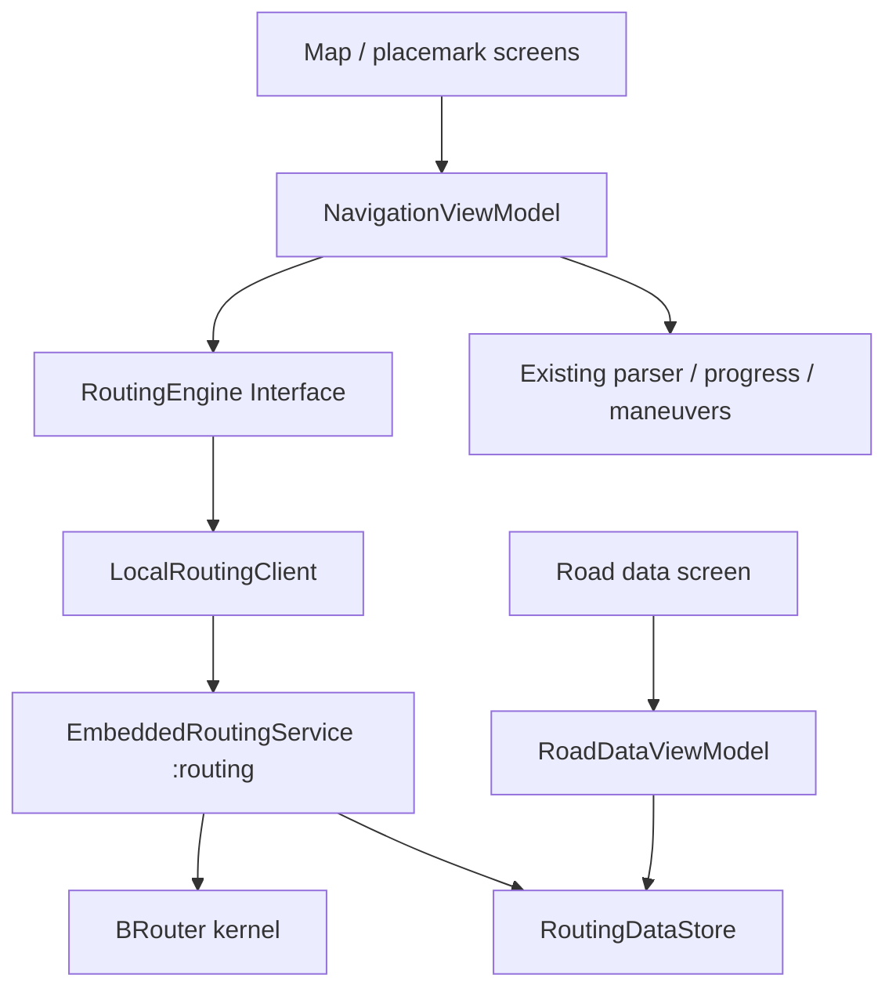

# Embedded routing architecture

## Implemented

The `RoutingEngine` Interface remains the seam used by NavigationViewModel.
It accepts two GeoPoints and returns Route or a typed RoutingException. The
ViewModel no longer checks a concrete BRouter adapter or an installed package.
MapFragment and PlacemarkModal still use the same activity-scoped controller.

LocalRoutingClient is the adapter at that seam. It owns binding, request IDs,
cancellation and worker serialization. EmbeddedRoutingService is private and
runs in `:routing`; it owns memory-heavy kernel calls and catches routing errors.
The process shares the app UID and data directory, but not the map/recording heap.

RoutingDataStore owns names, CRC validation, atomic import, profile installation
and directories. Its public Interface exposes segment metadata and stream import;
File paths and profile preparation are internal. RoadDataViewModel owns document
selection I/O and retained import state. The Fragment renders state through XML
and ViewBinding. No new DI framework or application-wide service locator is needed.

## Targeted improvements worth doing next

1. Extract the navigation panel's formatting and controls from MapFragment into
   a small UI Module with `render(NavigationState)` and action callbacks. MapFragment
   currently also handles layers, GPS camera, tracks and placemarks; panel changes
   should stay local as navigation features grow.
2. Move shared position/recording state out of LocationService static StateFlows
   into a location Module. Its Interface should expose position state and cadence
   requests; LocationService becomes the Android delivery adapter. This removes
   Android service knowledge from navigation and placemark ViewModels and enables
   simpler controller tests. Keep recording ownership independent of navigation.
3. Keep maps and routing data as distinct stores with the same import convention
   (private storage, atomic replacement, safe filenames). Only share the small
   document-copy mechanism if more import screens actually repeat it. Do not add
   a generic repository framework for the two existing formats.

These are focused recommendations, not prerequisites for the embedded engine.
The implementation fixes the concrete routing dependency and resource ownership
without rewriting unrelated screens or location providers.
